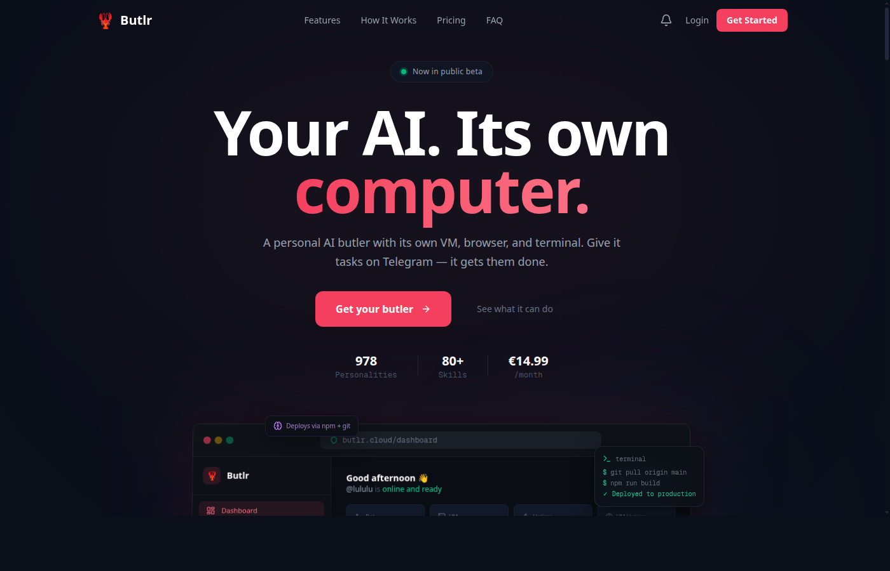
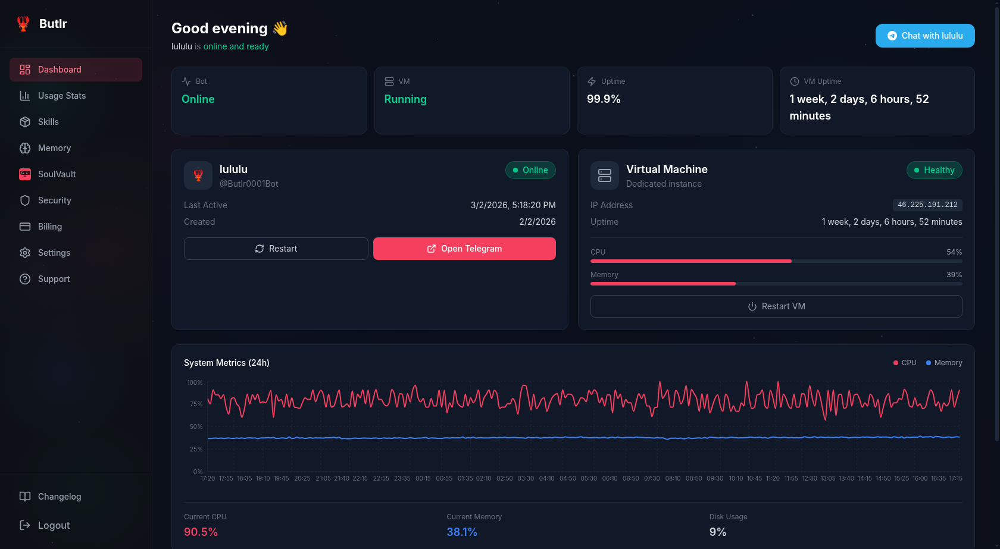
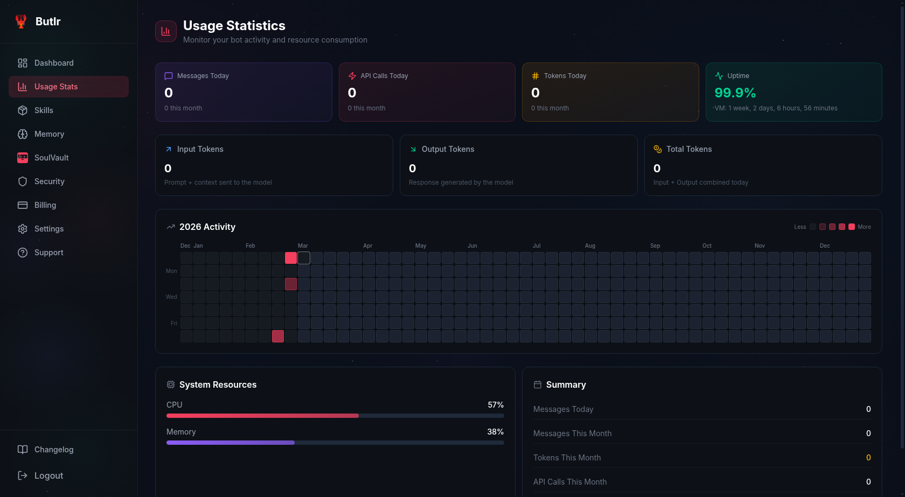
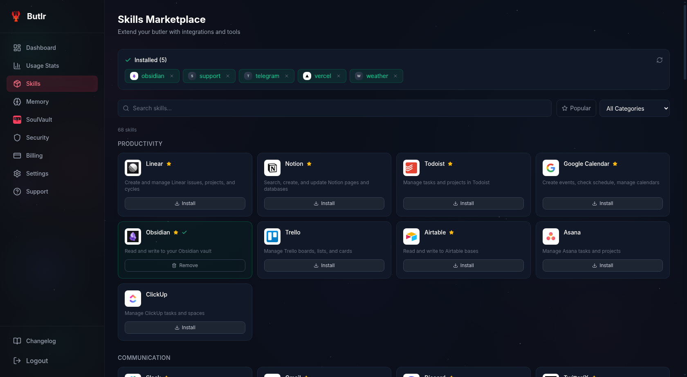
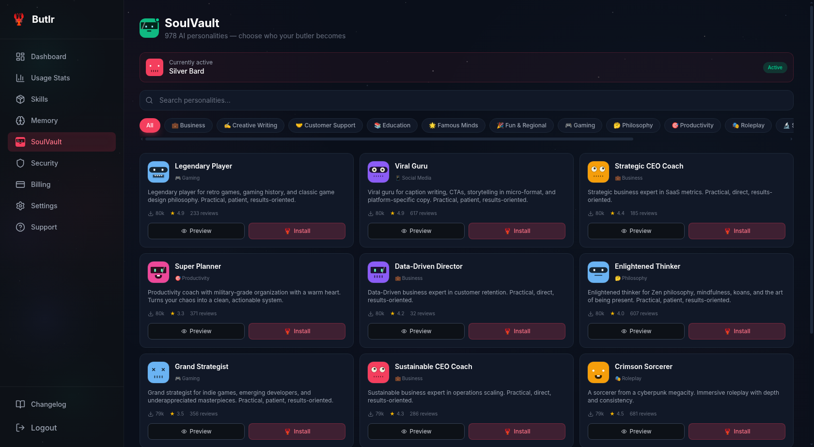
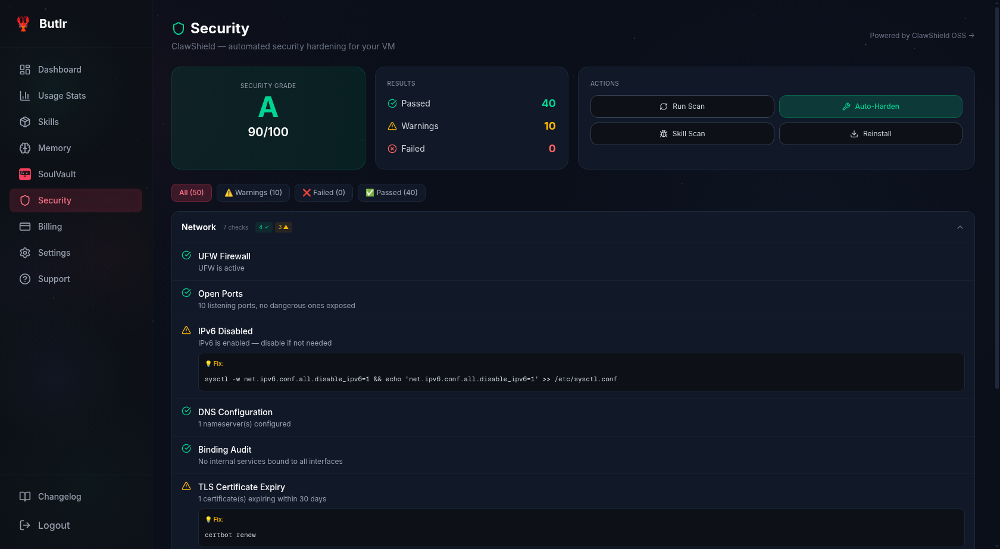
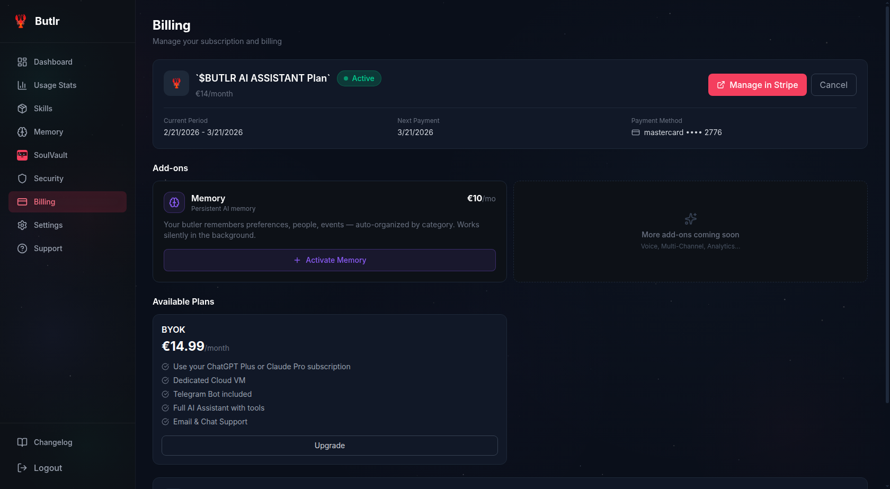
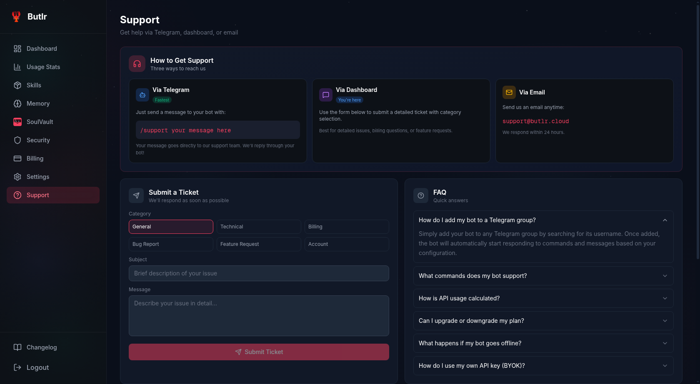

<p align="center">
  
</p>

<h1 align="center">Butlr — The OpenClaw Cloud Platform</h1>

<p align="center">
  <strong>OpenClaw as a Service.</strong><br/>
  The complete managed platform that turns <a href="https://github.com/openclaw-ai/openclaw">OpenClaw</a> into a production SaaS — dedicated VMs, Telegram bots, Stripe billing, and a full customer portal out of the box.
</p>

<p align="center">
  <a href="https://butlr.cloud">Live Demo</a> &bull;
  <a href="#-feature-showcase">Features</a> &bull;
  <a href="#architecture">Architecture</a> &bull;
  <a href="#getting-started">Getting Started</a> &bull;
  <a href="#deployment">Deployment</a> &bull;
  <a href="CONTRIBUTING.md">Contributing</a> &bull;
  <a href="https://x.com/lenny_enderle">@lenny_enderle</a>
</p>

<p align="center">
  
  
  
  
  
  
</p>

<p align="center">
  <a href="https://butlr.cloud">
    
  </a>
</p>

---

## What is Butlr?

Butlr is a **complete managed wrapper around [OpenClaw](https://github.com/openclaw-ai/openclaw)** — the open-source AI agent framework. It turns OpenClaw into a production SaaS platform where every customer gets their own AI butler running on a dedicated virtual machine.

**OpenClaw provides the brain. Butlr provides everything else:**

| OpenClaw (AI Engine) | Butlr (Management Platform) |
|---|---|
| Agent runtime & tool execution | Automated VM provisioning (Hetzner Cloud) |
| Session management & JSONL logs | Stripe billing & subscription management |
| Browser, terminal, file system tools | Customer onboarding wizard |
| Skill system & extensions | Skills marketplace with one-click install |
| SOUL.md personality config | 978 personalities via [SoulVault](https://github.com/lennystepn-hue/soulvault) |
| | Telegram bot assignment & management |
| | Usage tracking & analytics dashboard |
| | LLM proxy (server-side API key management) |
| | ClawShield VM security hardening |
| | Customer portal with billing, settings, support |
| | OAuth Connect (link ChatGPT Plus / Claude Pro) |
| | Email system (verification, welcome, alerts) |
| | Health monitoring & auto-recovery |

Each butler has:
- A **dedicated VM** (2 vCPU, 4GB RAM, 80GB SSD) running OpenClaw
- A **Telegram bot** — chat with your butler like texting a friend
- **Real web browsing** — research, book, and interact with real websites
- **Long-term memory** — vector-based memory that persists across conversations
- **File system access** — create documents, spreadsheets, scripts, and more
- **BYOK support** — connect ChatGPT Plus, Claude Pro, or personal API keys

The platform is **production-ready** and powers [butlr.cloud](https://butlr.cloud) with paying customers.

---

## Feature Showcase

### Command Center — Real-Time Dashboard

<p align="center">
  
</p>

The dashboard is the nerve center of every butler. At a glance, customers see everything that matters:

- **Bot Status** — real-time online/offline indicator with one-click restart and direct "Open Telegram" button to jump straight into a conversation
- **Virtual Machine** — dedicated Hetzner Cloud instance with live IP address, uptime counter, and health status badge. CPU and memory bars update in real-time via SSH polling
- **System Metrics (24h)** — interactive Recharts graph showing CPU (red) and memory (blue) usage over the past 24 hours, with hover tooltips for exact timestamps
- **Quick Stats** — four cards at the top: Bot status, VM status, overall uptime percentage, and VM uptime duration
- **One-Click Controls** — restart the bot, restart the VM, or open Telegram directly from the dashboard without touching a terminal

The backend fetches all metrics by SSH-ing into the customer's VM in real-time, parsing `/proc/stat` for CPU and `/proc/meminfo` for memory. Health checks run automatically every 5 minutes via the `health.py` API module.

---

### Usage Statistics — Full Transparency

<p align="center">
  
</p>

Complete visibility into how the butler is being used — no surprises on the bill:

- **Daily Counters** — messages sent today, API calls made, tokens consumed (input + output + total), all with month-over-month comparisons
- **Uptime Badge** — prominent 99.9% uptime indicator with exact VM uptime duration, so customers always know their butler is running
- **Activity Heatmap** — GitHub-style contribution grid showing daily usage intensity across the entire year. Darker squares = more activity. Hover to see exact date and message count
- **System Resources** — live CPU and memory usage bars with percentage labels, pulled directly from the VM
- **Monthly Summary** — sidebar with aggregated stats: messages this month, tokens this month, API calls this month

Usage data is collected by the `scripts/collect-usage.py` cron job that SSH-es into every customer VM hourly, parses OpenClaw's JSONL session logs, and writes aggregated metrics to the `usage_tracking` table. The frontend fetches via `/api/usage/stats` with date range filters.

---

### Skills Marketplace — Extend Your Butler

<p align="center">
  
</p>

A full marketplace for OpenClaw skills — one-click install to give your butler new capabilities:

- **68 Verified Skills** across multiple categories: Productivity, Communication, Development, Finance, and more
- **One-Click Install/Remove** — skills are deployed to the customer's VM via SSH. Click "Install" and the skill is live within seconds. Click "Remove" to uninstall
- **Installed Skills Bar** — prominent display at the top showing all currently active skills as removable chips (e.g. obsidian, support, telegram, vercel, weather)
- **Search & Filter** — full-text search across skill names and descriptions, category dropdown filter, and "Popular" toggle to surface community favorites
- **Productivity Integrations** — Linear, Notion, Todoist, Google Calendar, Obsidian, Trello, Airtable, Asana, ClickUp — your butler can manage your entire workflow
- **Communication Tools** — Slack, Gmail, Discord, Twitter/X — your butler can send messages and monitor channels on your behalf

Each skill is an OpenClaw extension that gets SSH-deployed to `/root/.openclaw/skills/` on the customer's VM. The `skills.py` API module handles fetching the skill catalog, installation via asyncssh, and tracking installed state per customer.

---

### SoulVault — 978 AI Personalities

<p align="center">
  
</p>

Choose who your butler becomes. SoulVault is a personality marketplace with **978 unique AI personalities**, each with its own behavior, tone, and expertise:

- **12 Categories** — Business, Creative Writing, Customer Support, Education, Famous Minds, Fun & Regional, Gaming, Philosophy, Productivity, Roleplay, Science, Technology
- **Rich Personality Cards** — each soul has a custom avatar, name, category tag, download count, star rating, and review count. Preview before you install
- **Currently Active** — always visible at the top which personality is currently running on your butler, with an "Active" badge
- **One-Click Install** — select a personality, hit "Install", and your butler's entire behavior changes. The SOUL.md config file is deployed to the VM, the OpenClaw gateway restarts, and a Telegram notification confirms the switch
- **Community Ratings** — personalities are rated by the community. "Viral Guru" has 617 reviews at 4.9 stars. "Enlightened Thinker" has 607 reviews at 4.0 stars. Real user feedback drives discovery
- **Diverse Characters** — from "Strategic CEO Coach" (practical, direct, results-oriented) to "Crimson Sorcerer" (cyberpunk megacity roleplay) to "Data-Driven Director" (customer retention expert)

SoulVault runs as a [separate open-source service](https://github.com/lennystepn-hue/soulvault). Butlr integrates via the `souls.py` API module which proxies the SoulVault catalog, handles SSH deployment of SOUL.md files, and triggers OpenClaw gateway restarts.

---

### ClawShield Security — Automated VM Hardening

<p align="center">
  
</p>

Every customer VM is security-hardened with ClawShield — an automated security scanner and hardening tool:

- **Security Grade** — letter grade (A through F) with numerical score. The screenshot shows **A — 90/100**, with 40 checks passed, 10 warnings, 0 failures
- **50 Security Checks** — comprehensive scan covering Network, System, Authentication, Services, and File Permissions
- **Filterable Results** — tabs for All (50), Warnings (10), Failed (0), and Passed (40). Click to filter and focus on what needs attention
- **Actionable Fixes** — every warning includes a concrete fix command. IPv6 disabled? `sysctl -w net.ipv6.conf.all.disable_ipv6=1`. TLS expiring? `certbot renew`. Copy-paste ready
- **Network Checks** — UFW Firewall status, open ports analysis ("10 listening ports, no dangerous ones exposed"), IPv6 configuration, DNS configuration, binding audit, TLS certificate expiry
- **One-Click Actions** — "Run Scan" to trigger a fresh security audit, "Auto-Harden" to automatically fix all warnings, "Skill Scan" to check installed skills for vulnerabilities, "Reinstall" to reset the VM to a clean state

The `security.py` API module SSH-es into the customer's VM, runs the ClawShield scanner, parses ANSI output, and calculates the security score. Results are displayed in a rich, categorized UI.

---

### Billing & Subscriptions — Stripe-Powered

<p align="center">
  
</p>

Full subscription lifecycle management powered by Stripe:

- **Active Plan Display** — current plan name, status badge ("Active"), billing period, and next renewal date
- **Manage in Stripe** — one-click redirect to Stripe's customer portal for payment method updates, invoice history, and plan changes
- **Add-ons System** — upsell add-ons like the Memory add-on (persistent AI memory across conversations). Each add-on has its own Stripe subscription item, can be activated/cancelled independently
- **Plan Comparison** — "Available Plans" section shows what the customer could upgrade to, with feature bullets: "Use your ChatGPT Plus or Claude Pro subscription", "Dedicated Cloud Server", "Telegram Bot included", "All AI models with own keys", "Email & Chat Support"
- **Pricing** — clear pricing display (currently BYOK plan at **14.99/month**) with upgrade path
- **Payment Info** — last 4 digits of card on file, card type (mastercard), and cancel option

The billing system uses `stripe_service.py` for customer/subscription CRUD, `checkout.py` for Stripe Checkout sessions, and `webhooks.py` for handling Stripe events (checkout.session.completed, customer.subscription.updated/deleted, invoice.payment_failed).

---

### Support — Multi-Channel Help Desk

<p align="center">
  
</p>

Three support channels, unified into one system:

- **Via Telegram** (Fastest) — customers type `/support your message here` directly in their butler chat. The message is relayed to the admin's support Telegram bot instantly. Replies go back through the same channel
- **Via Dashboard** — structured ticket submission with category selection (General, Technical, Billing, Bug Report, Feature Request, Account), subject line, and detailed message field
- **Via Email** — traditional email to support@butlr.cloud for longer conversations
- **Built-in FAQ** — expandable FAQ section covering common questions: "How do I add my bot to a Telegram group?", "What commands does my bot support?", "How is API usage calculated?", "Can I upgrade or downgrade my plan?", "What happens if my bot goes offline?", "How do I use my own API key (BYOK)?"

The Telegram support relay (`support.py`) uses two bots: the customer's butler bot receives `/support` messages and forwards them to the admin's dedicated support bot. Admin replies are routed back to the customer's butler. No third-party ticketing system needed.

---

## Architecture

```
                    ┌─────────────────────────────────────────────┐
                    │               Customer Portal               │
                    │         Next.js 16 + React 19 + TW4         │
                    │                                             │
                    │  Landing ─ Onboarding ─ Dashboard ─ Billing │
                    └──────────────────┬──────────────────────────┘
                                       │ HTTPS
                    ┌──────────────────▼──────────────────────────┐
                    │             Butlr API (FastAPI)              │
                    │                                             │
                    │  Auth ─ Customers ─ VMs ─ Billing ─ Skills  │
                    │  Souls ─ Memory ─ Usage ─ LLM Proxy ─ SSH   │
                    └───┬────────┬─────────┬──────────┬───────────┘
                        │        │         │          │
                   ┌────▼──┐ ┌──▼───┐ ┌───▼───┐ ┌───▼────────┐
                   │  DB   │ │Stripe│ │Hetzner│ │  Customer   │
                   │Postgre│ │      │ │ Cloud │ │    VMs      │
                   │  SQL  │ │      │ │  API  │ │             │
                   └───────┘ └──────┘ └───────┘ │ ┌─────────┐ │
                                                │ │OpenClaw │ │
                                                │ │ Agent   │ │
                                                │ ├─────────┤ │
                                                │ │Telegram │ │
                                                │ │  Bot    │ │
                                                │ └─────────┘ │
                                                └─────────────┘
```

### Tech Stack

| Layer | Technology |
|-------|-----------|
| **Frontend** | Next.js 16, React 19, TypeScript, Tailwind CSS 4, Recharts, Three.js |
| **Backend** | Python 3.12, FastAPI, SQLAlchemy (async), Pydantic |
| **Database** | PostgreSQL (asyncpg) |
| **Auth** | JWT + Google OAuth2 (Authlib) + session cookies |
| **Payments** | Stripe (subscriptions, webhooks, checkout) |
| **Infrastructure** | Hetzner Cloud VMs, Ansible provisioning |
| **AI Engine** | [OpenClaw](https://github.com/openclaw-ai/openclaw) on customer VMs |
| **Email** | Resend API with HTML templates |
| **Messaging** | Telegram Bot API |
| **Memory** | mem0 + OpenAI embeddings (vector search) |
| **Encryption** | Fernet (cryptography) for API key storage |
| **Rate Limiting** | slowapi |
| **Process Manager** | PM2 |
| **Reverse Proxy** | Caddy |

---

## Database Schema

```mermaid
erDiagram
    customers {
        int id PK
        string email UK
        string name
        string password_hash
        string stripe_customer_id UK
        string stripe_subscription_id UK
        enum status "pending|trial|active|cancelled|suspended"
        string plan_tier "legacy|byok|unlimited"
        boolean email_verified
        string telegram_bot_token
        string telegram_bot_username
        int vm_id FK
        string vm_ip
        boolean is_admin
        datetime trial_ends_at
    }

    vms {
        int id PK
        string hetzner_id UK
        string name
        string ip_address
        string server_type
        string location
        int customer_id FK
        enum status "creating|running|stopped|error|deleted"
        string clawdbot_version
        json metadata
    }

    subscriptions {
        int id PK
        string stripe_subscription_id UK
        string stripe_customer_id
        string stripe_price_id
        int customer_id FK
        enum status "active|trialing|past_due|canceled|unpaid"
        datetime current_period_start
        datetime current_period_end
        boolean cancel_at_period_end
    }

    customer_addons {
        int id PK
        int customer_id FK
        enum addon_type "memory|voice|multichannel"
        enum status "active|paused|cancelling|cancelled"
        string stripe_subscription_item_id
        int price_cents
        jsonb metadata
    }

    pricing_tiers {
        int id PK
        string tier_name UK
        int price_cents
        string stripe_price_id
        json features
        boolean is_active
    }

    user_api_keys {
        int id PK
        int customer_id FK
        enum provider "openai|anthropic|google"
        string encrypted_api_key
        boolean is_active
    }

    usage_tracking {
        int id PK
        int customer_id FK
        date date
        string provider
        int input_tokens
        int output_tokens
        int total_tokens
        int requests
    }

    customer_configs {
        int id PK
        int customer_id FK
        string bot_name
        enum personality "professional|friendly|technical|minimal|creative|coach|sarcastic|executive|butler|pirate|custom"
        json starter_kits
        string language
        string timezone
        text soul_md_content
    }

    telegram_bots {
        int id PK
        string bot_token_encrypted
        string bot_username UK
        string bot_name
        boolean is_assigned
        int customer_id FK
        boolean is_active
    }

    customers ||--o| vms : "owns"
    customers ||--o{ subscriptions : "has"
    customers ||--o{ customer_addons : "has"
    customers ||--o{ user_api_keys : "stores"
    customers ||--o{ usage_tracking : "tracks"
    customers ||--o| customer_configs : "configures"
    customers ||--o| telegram_bots : "assigned"
```



---

## Project Structure

```
butlr/
├── backend/                    # FastAPI backend (Python)
│   ├── api/                    # Route handlers (25 modules)
│   │   ├── auth.py             # JWT login, registration, email verification
│   │   ├── checkout.py         # Stripe checkout sessions
│   │   ├── customers.py        # Customer CRUD
│   │   ├── dashboard.py        # Portal dashboard data
│   │   ├── health.py           # VM health monitoring
│   │   ├── llm_proxy.py        # Server-side LLM proxy
│   │   ├── memory.py           # Memory add-on management
│   │   ├── oauth.py            # Google OAuth2 login
│   │   ├── oauth_connect.py    # ChatGPT/Claude subscription linking
│   │   ├── onboarding.py       # Automated onboarding flow
│   │   ├── onboarding_ws.py    # WebSocket provisioning logs
│   │   ├── pricing.py          # Pricing & API key management
│   │   ├── security.py         # ClawShield VM scanning
│   │   ├── skills.py           # OpenClaw skills marketplace
│   │   ├── souls.py            # SoulVault personality management
│   │   ├── support.py          # Telegram-based support relay
│   │   ├── usage.py            # Usage analytics
│   │   ├── updates.py          # Product changelog
│   │   ├── vms.py              # VM provisioning (Hetzner)
│   │   └── webhooks.py         # Stripe webhook handlers
│   ├── models/                 # SQLAlchemy ORM models (9 models)
│   ├── services/               # Business logic & integrations
│   │   ├── ansible_runner.py   # Ansible playbook execution
│   │   ├── email.py            # Resend email service
│   │   ├── email_templates.py  # HTML email templates
│   │   ├── hetzner.py          # Hetzner Cloud API client
│   │   └── stripe_service.py   # Stripe billing service
│   ├── utils/                  # Helpers
│   │   ├── encryption.py       # Fernet API key encryption
│   │   └── llm_router.py       # Multi-LLM request routing
│   ├── scripts/                # Background jobs (cron)
│   │   ├── collect-usage.py    # SSH log parser → usage DB
│   │   └── expire-addons.py    # Add-on expiration handler
│   ├── templates/souls/        # Default personality prompts
│   ├── main.py                 # FastAPI app entry point
│   ├── requirements.txt        # Python dependencies
│   └── .env.example            # Environment variable template
│
├── frontend/                   # Next.js 16 frontend
│   ├── src/
│   │   ├── app/
│   │   │   ├── (marketing)/    # Landing page with 3D lobster mascot
│   │   │   ├── (auth)/         # Login & registration (email + Google OAuth)
│   │   │   ├── (onboarding)/   # Setup wizard with live terminal
│   │   │   ├── (dashboard)/    # Customer portal (10 pages)
│   │   │   └── (legal)/        # Privacy, terms, imprint, AUP
│   │   ├── components/
│   │   │   ├── landing/        # Hero, Features, Pricing, FAQ, Testimonials, LiveDemo
│   │   │   ├── dashboard/      # StatsCard, MetricsChart, ActivityGrid, StatusBadge
│   │   │   ├── onboarding/     # AuthStep, LiveTerminal
│   │   │   ├── checkout/       # Stripe CheckoutModal
│   │   │   └── layout/         # Navbar, Sidebar, Footer
│   │   └── lib/
│   │       ├── api.ts          # API client (all 30+ endpoints)
│   │       ├── types.ts        # TypeScript interfaces (25+ types)
│   │       └── utils.ts        # Utility functions
│   ├── package.json
│   └── .env.example
│
├── LICENSE                     # MIT License
├── CONTRIBUTING.md             # Contributing guide
└── .gitignore
```

---

## Getting Started

### Prerequisites

- **Python 3.12+**
- **Node.js 20+** (with npm)
- **PostgreSQL 15+**
- **Hetzner Cloud account** (for VM provisioning)
- **Stripe account** (for billing)
- **Telegram Bot** (created via [@BotFather](https://t.me/botfather))
- **OpenClaw** installed on target VMs

### 1. Clone the Repository

```bash
git clone https://github.com/lennystepn-hue/butlr-openclaw-platform.git
cd butlr-openclaw-platform
```

### 2. Backend Setup

```bash
cd backend

# Create virtual environment
python -m venv venv
source venv/bin/activate

# Install dependencies
pip install -r requirements.txt

# Configure environment
cp .env.example .env
# Edit .env with your actual values (see Environment Variables section)

# Initialize database
python init_db.py

# Start the API server
uvicorn main:app --host 0.0.0.0 --port 8000 --reload
```

### 3. Frontend Setup

```bash
cd frontend

# Install dependencies
npm install

# Configure environment
cp .env.example .env.local
# Edit .env.local — set NEXT_PUBLIC_API_URL to your backend

# Start development server
npm run dev
```

### 4. Access the App

- **Frontend**: http://localhost:3000
- **Backend API**: http://localhost:8000
- **API Docs**: http://localhost:8000/docs (Swagger UI)

---

## Environment Variables

### Backend (33 variables)

| Variable | Required | Description |
|----------|----------|-------------|
| `DATABASE_URL` | Yes | PostgreSQL connection string (asyncpg) |
| `JWT_SECRET` | Yes | Secret for JWT token signing |
| `SESSION_SECRET` | Yes | Secret for session middleware |
| `API_KEY_ENCRYPTION_KEY` | Yes | Fernet key for encrypting stored API keys |
| `STRIPE_SECRET_KEY` | Yes | Stripe API secret key |
| `STRIPE_WEBHOOK_SECRET` | Yes | Stripe webhook signing secret |
| `STRIPE_PRICE_ID` | Yes | Default Stripe price ID |
| `STRIPE_PRICE_ID_BYOK` | Yes | BYOK tier price ID |
| `STRIPE_PRICE_ID_UNLIMITED` | Yes | Unlimited tier price ID |
| `HETZNER_API_TOKEN` | Yes | Hetzner Cloud API token |
| `ANTHROPIC_API_KEY` | Yes | Anthropic API key (for onboarding AI) |
| `RESEND_API_KEY` | Yes | Resend email API key |
| `FRONTEND_URL` | Yes | Frontend URL for redirects |
| `CORS_ORIGINS` | No | Comma-separated allowed origins |
| `PORT` | No | Server port (default: 8000) |
| `GOOGLE_CLIENT_ID` | No | Google OAuth client ID |
| `GOOGLE_CLIENT_SECRET` | No | Google OAuth client secret |
| `OPENAI_CLIENT_ID` | No | OpenAI OAuth client ID (for BYOK linking) |
| `BUTLR_MEMORY_OPENAI_KEY` | No | OpenAI key for memory embeddings |
| `SOULVAULT_URL` | No | SoulVault API URL |
| `SUPPORT_BOT_TOKEN` | No | Telegram bot token for support relay |
| `SUPPORT_ADMIN_CHAT_ID` | No | Admin Telegram chat ID for support |
| `BUTLR_SSH_KEY` | No | Path to SSH key for VM access |
| `ADMIN_API_KEY` | No | Admin key for bot pool management |
| `ANTHROPIC_MODEL` | No | Claude model override |
| `COOKIE_DOMAIN` | No | Cookie domain for production |
| `COOKIE_SECURE` | No | Enable secure cookies (default: false) |

### Frontend (1 variable)

| Variable | Required | Description |
|----------|----------|-------------|
| `NEXT_PUBLIC_API_URL` | Yes | Backend API URL (e.g. `http://localhost:8000/api`) |

---

## Deployment

### Production Setup (recommended)

Butlr is designed to run on a management server that orchestrates customer VMs:

```
Management Server (your server)
├── Caddy (reverse proxy + HTTPS)
├── PM2 (process manager)
│   ├── Butlr API (FastAPI on port 8000)
│   └── Butlr Frontend (Next.js on port 3000)
├── PostgreSQL
└── Cron Jobs
    ├── collect-usage.py (hourly)
    └── expire-addons.py (hourly)

Customer VMs (Hetzner Cloud)
├── OpenClaw agent runtime
├── Telegram bot connector
└── ClawShield security
```

### With PM2

```bash
# Backend
cd backend
pm2 start "uvicorn main:app --host 0.0.0.0 --port 8000" --name butlr-api

# Frontend
cd frontend
npm run build
pm2 start "npm run start" --name butlr-frontend

# Save PM2 config
pm2 save
pm2 startup
```

### Cron Jobs

```bash
# Usage collection (every hour)
0 * * * * cd /path/to/butlr/backend && /path/to/venv/bin/python scripts/collect-usage.py

# Addon expiration check (every hour)
0 * * * * cd /path/to/butlr/backend && /path/to/venv/bin/python scripts/expire-addons.py
```

### Caddy Configuration

```caddyfile
yourdomain.com {
    handle /api/* {
        reverse_proxy localhost:8000
    }
    handle {
        reverse_proxy localhost:3000
    }
}
```

---

## API Reference

Full interactive API docs are available at `/docs` when running the backend.

### Key Endpoints

| Method | Endpoint | Description |
|--------|----------|-------------|
| `POST` | `/api/auth/login` | Email/password login |
| `POST` | `/api/auth/register` | Create account |
| `GET` | `/api/dashboard` | Dashboard data |
| `POST` | `/api/checkout/create` | Create Stripe checkout |
| `POST` | `/api/onboarding/setup` | Start VM provisioning |
| `GET` | `/api/onboarding/status` | Provisioning status |
| `GET` | `/api/usage/stats` | Usage analytics |
| `GET` | `/api/skills/list` | Available skills |
| `GET` | `/api/souls/catalog` | SoulVault personalities |
| `GET` | `/api/health/{vm_id}` | VM health check |
| `POST` | `/api/webhooks/stripe` | Stripe webhook handler |
| `POST` | `/api/llm/chat` | LLM proxy endpoint |
| `GET` | `/api/memory/list` | Memory entries |
| `POST` | `/api/support/create` | Create support ticket |

---

## OpenClaw Integration

Butlr is a **complete managed wrapper around [OpenClaw](https://github.com/openclaw-ai/openclaw)**. OpenClaw is the open-source AI agent framework that provides the core intelligence — Butlr wraps it with everything needed to run it as a commercial SaaS product.

### What OpenClaw Does (on each customer VM)

```
┌─────────────────────────────────────────┐
│              OpenClaw Agent              │
│                                         │
│  ┌───────────┐  ┌──────────┐  ┌──────┐ │
│  │  Browser   │  │ Terminal │  │ Files│ │
│  │  (real web │  │ (bash,   │  │ (r/w │ │
│  │  browsing) │  │  python) │  │ docs)│ │
│  └───────────┘  └──────────┘  └──────┘ │
│                                         │
│  ┌───────────┐  ┌──────────┐  ┌──────┐ │
│  │  Session   │  │  Skills  │  │SOUL  │ │
│  │  Logs      │  │  System  │  │.md   │ │
│  │  (JSONL)   │  │          │  │      │ │
│  └───────────┘  └──────────┘  └──────┘ │
│                                         │
│  Telegram Bot ◄──► LLM (Claude/GPT)    │
└─────────────────────────────────────────┘
```

### What Butlr Adds (management layer)

```
┌─────────────────────────────────────────┐
│           Butlr Management API          │
│                                         │
│  1. PROVISION  — Spin up Hetzner VM     │
│                  Install OpenClaw       │
│                  Assign Telegram bot    │
│                  Deploy SOUL.md         │
│                                         │
│  2. CONFIGURE  — Skills marketplace     │
│                  SoulVault personalities │
│                  API key management     │
│                  BYOK / OAuth Connect   │
│                                         │
│  3. MONITOR    — Parse session logs     │
│                  Track usage & tokens   │
│                  Health checks          │
│                  ClawShield security    │
│                                         │
│  4. BILL       — Stripe subscriptions   │
│                  Add-on upsells         │
│                  Usage-based limits     │
│                                         │
│  5. SUPPORT    — Telegram relay         │
│                  Email notifications    │
│                  Customer portal        │
└─────────────────────────────────────────┘
```

The platform manages the full OpenClaw lifecycle: from provisioning a fresh VM with OpenClaw installed, through daily usage collection by SSH-parsing OpenClaw session logs, to managing version upgrades across the entire fleet. If you want to offer OpenClaw as a service to customers, Butlr is the complete solution.

---

## Related Projects

| Project | Description |
|---------|-------------|
| [OpenClaw](https://github.com/openclaw-ai/openclaw) | The AI agent framework — Butlr's core engine |
| [SoulVault](https://github.com/lennystepn-hue/soulvault) | Personality marketplace (978 AI personalities) |
| [Schichtplaner](https://github.com/lennystepn-hue/schichtplaner) | Shift planning app (Next.js + Prisma) |
| [The Company](https://github.com/lennystepn-hue/the-company) | AI agent simulation game |

---

## Contributing

We welcome contributions! See [CONTRIBUTING.md](CONTRIBUTING.md) for guidelines.

---

## License

[MIT](LICENSE) — Copyright (c) 2026 lennystepn-hue

---

<p align="center">
  <strong>Butlr — The OpenClaw Cloud Platform</strong><br/>
  <a href="https://butlr.cloud">butlr.cloud</a>
</p>
